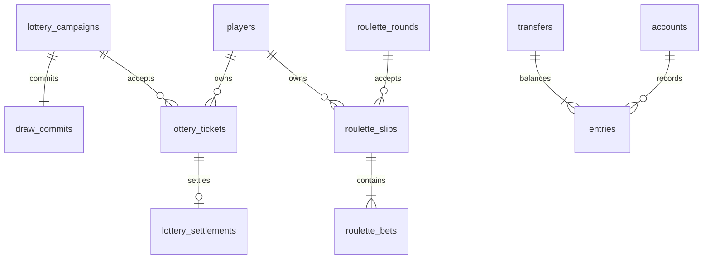

# Migrasi dan model data

Migrasi schema additive/idempotent: src/rc-schema.mjs dipanggil openDb. `scripts/migrate.mjs` membuat backup konsisten sebelum schema lalu memeriksa ledger, integritas, dan reservasi kewajiban lama. Tidak ada DROP/TRUNCATE atau UPDATE saldo pemain pada migration. Status histori instan diberi label LEGACY_INSTANT_DRAW saat projection; baris sumber tidak diubah.

| Table | Constraint / peran |
|---|---|
| schema_migrations | PK version; marker migrasi additive |
| stake_policies | PK tenant_id,game_code; JSON aturan/version |
| policy_audit | actor + before/after immutable history |
| rc_commands | PK tenant,actor,command; fingerprint dan respons JSON |
| treasury_reserves | PK reservation id, amount nonnegative; guard transfer treasury |
| lottery_campaigns | immutable rules_json, state/version, schedule/result |
| draw_commits | PK round_id, seed privat + commitment; reveal timestamp |
| lottery_tickets | pemain, guess string, harga, status, created |
| lottery_settlements | PK ticket_id; satu settlement per tiket |
| roulette_rounds | policy/paytable snapshot, close deadline, shared result |
| roulette_slips | UNIQUE round_id,player_id; stake/exposure/status/payout |
| roulette_bets | PK slip_id,position; seluruh item slip |
| round_audit | event berurutan per round, actor/detail/time |
| outbox (lama) | transaksi state+ledger+event satu commit; cursor per player |

Treasury reserve adalah kewajiban, bukan saldo account baru; jumlah supply tetap. Setiap debit/payout/refund/alokasi menggunakan transfer dengan dua entry berjumlah nol. Transfer menolak overdraft, overflow dan pengeluaran yang memakan reserve ronde lain. Pada settlement, release reserve + payout + state + outbox atomik di satu BEGIN IMMEDIATE.

Lottery DRAFT→OPEN→CLOSED→DRAWING→PUBLISHED→SETTLED; cancel sebelum hasil. PUBLISHED/SETTLED satu transaksi publikasi sehingga restart tidak melihat payout separuh. Recovery juga menerima state DRAWING/PUBLISHED yang persisten. Roulette OPEN_BETS→LOCKED→SPINNING→SETTLED; state SPINNING menyimpan result sehingga restart tidak reroll. Cancel hanya sebelum result.

Single-tenant baseline wa-world dipertahankan, request tenant lain ditolak. PostgreSQL belum backend aktif. Untuk deployment multi-instance: port transaksi ke async connection pool, BIGINT ACR, row SELECT FOR UPDATE round/account, unique command/settlement constraints sama, transaction outbox worker dengan SKIP LOCKED + delivery keys, advisory lock scheduler, migrasi read-only snapshot SQLite ke staging PostgreSQL dengan rekonsiliasi jumlah ledger/saldo. Jalankan ulang race/chaos/load suite di PostgreSQL sebelum cutover. Jangan menyalakan beberapa proses SQLite untuk mengklaim HA.
