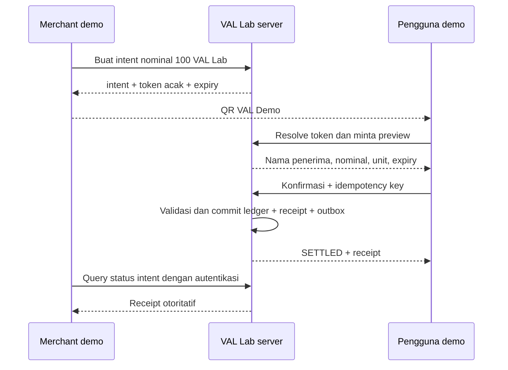

# Lab QR VAL, DANA, dan QRIS

Status: panduan belajar dan kontrak usulan; belum ada integrasi provider aktif. Indeks: [WAW & VAL](README.md).

## Tiga hal yang berbeda

| Jalur | Tujuan | Saldo | Tempat berjalan |
|---|---|---|---|
| QR VAL Demo | Memahami scan, konfirmasi, settlement, receipt, refund | VAL Lab sintetis | Database lab lokal |
| Sandbox DANA/provider QRIS | Memahami API, signature, callback, status enquiry | Data uji provider | Proyek lab dan kredensial sandbox terpisah |
| Pembayaran produksi | Pembayaran uang nyata lewat penyelenggara terkait | Uang nyata | Di luar roadmap kasino nol uang |

QRIS adalah standar pembayaran; membuat gambar QR sendiri tidak menjadikan aplikasi peserta QRIS. BI menjelaskan bahwa merchant mendaftar melalui PJP QRIS berizin, sedangkan PJP/switching yang memproses QRIS memerlukan persetujuan BI. [Penjelasan resmi QRIS](https://www.bi.go.id/id/fungsi-utama/sistem-pembayaran/ritel/kanal-layanan/qris/default.aspx).

VAL tidak mengklaim izin penerbit uang elektronik atau interoperabilitas DANA. Sistem nol uang ini tidak mempunyai endpoint IDR→VAL, VAL→IDR, cash-out, atau hadiah barang bernilai nyata. Jika suatu hari WAW memiliki bisnis pembayaran riil, rancang proyek, ledger, akses, onboarding provider, dan kajian regulasinya secara terpisah; jangan menjadikannya sumber saldo taruhan.

## Latihan 1: QR dinamis internal

Mulai dari QR dinamis yang mengacu ke satu intent dengan nominal tetap. Setelah memahami ini, QR statis dapat mengacu ke merchant demo dan membuat intent baru setelah nominal dimasukkan.

Payload QR contoh: `val-demo://pay/<opaque-token>`. Token acak minimal 128 bit, expiry usulan 120 detik, dan pemetaan server ke intent. Ini format internal yang diusulkan, tidak kompatibel QRIS atau aplikasi DANA. Jangan menaruh nama/nomor WA, secret service, saldo, atau nominal yang dipercaya langsung di QR. Scanner VAL hanya memproses scheme/host yang diizinkan dan tidak mengakses URL arbitrer dari QR.

Pemindaian hanya menampilkan preview; GET tidak mendebit. Token QR hanya memberi akses preview minimum, bukan hak mengambil saldo. Pengguna harus login dan menekan konfirmasi setelah melihat penerima, nominal, serta label “Simulasi — tidak menggunakan uang nyata”. Token yang tersebar tidak boleh membuka riwayat atau data pribadi.

State intent internal: `CREATED → SETTLED`, atau `CREATED → EXPIRED/CANCELLED`. Settlement, consume token, jurnal, receipt dan outbox satu transaksi; status permanen `PROCESSING` tidak diperlukan untuk pembayaran internal sinkron. Expiry dicek dari jam server di transaksi yang sama. Dua pengguna yang mengonfirmasi intent yang sama secara bersamaan hanya boleh menghasilkan satu pembayaran. Request berikutnya hanya mendapat receipt jika berhak, atau error sudah dibayar tanpa bocoran identitas payer.

Refund adalah objek dan jurnal terpisah dengan referensi ke pembayaran asli; status pembayaran dapat memiliki proyeksi `PARTIALLY_REFUNDED/REFUNDED`. Penjumlahan refund dikunci terhadap pembayaran yang sama. Menghapus receipt lama atau membalik saldo di browser bukan refund.

## Latihan 2: simulator provider lokal

Buat fake provider dengan skenario sukses, ditolak, pending, timeout, callback berulang, callback terlambat, callback palsu, dan callback berurutan terbalik. Gunakan akun sintetis dan secret lab baru. Simulator adalah alat belajar, bukan emulator lengkap spesifikasi DANA atau sertifikasi QRIS.

- State adapter remote: `CREATED → PENDING/UNKNOWN → SUCCEEDED/FAILED`; timeout berarti `UNKNOWN`, bukan gagal final.
- Query status provider memakai reference yang sama sebelum mencoba tindakan baru. Jangan mengganti ID setiap kali jaringan gagal.
- Callback diverifikasi sesuai kontrak simulator, kemudian event ID dideduplikasi. Nominal, currency, merchant, environment dan reference harus cocok.
- State terminal tidak diturunkan oleh callback lama. Konflik diparkir untuk enquiry/rekonsiliasi, tidak diatasi dengan menambah saldo lagi.
- Expiry intent lokal tidak membuktikan kegagalan pembayaran remote; callback sukses terlambat masuk jalur rekonsiliasi/refund sesuai kontrak provider.
- Jangan gunakan screenshot, redirect browser, atau pesan “sukses” dari klien sebagai bukti settlement.

## Latihan 3: sandbox resmi

DANA menyediakan API test mode yang tidak memengaruhi data live atau berinteraksi dengan jaringan perbankan. Gunakan URL dan kredensial lingkungan yang sesuai; dokumentasi mencantumkan sandbox `https://api.sandbox.dana.id`. [Dokumentasi API DANA](https://dashboard.dana.id/api-docs-v2/api).

Dokumentasi autentikasi Open API DANA menjelaskan signature asimetris dan perolehan kredensial testing. Detail signature mengikuti produk/API yang dipilih; jangan menyalin skema autentikasi satu produk untuk seluruh endpoint. [Autentikasi resmi DANA](https://dashboard.dana.id/api-docs-v2/guide/authentication/authentication-open-api).

Langkah praktik:

1. Buat direktori/proyek lab dan database baru, tidak memakai database Arcade atau WA-WORLD.
2. Pilih produk yang tersedia pada akun sandbox; konfirmasi akses fitur QRIS sandbox di portal/dokumentasi provider. Keberadaan dokumentasi publik tidak menjamin produk itu aktif pada akun Anda.
3. Ikuti onboarding sandbox dan simpan kredensial pada secret store atau `.env` lab yang tidak dilacak Git. Jangan memakai `.env` Arcade.
4. Implementasikan signing sesuai versi dokumentasi produk, timestamp, canonical request, dan test vector resminya. Signature callback juga harus diverifikasi sesuai spesifikasi provider.
5. Buat request nominal uji, simpan merchant reference dan provider reference; tampilkan hanya data uji dan statusnya di lab.
6. Jika callback memerlukan URL publik, gunakan endpoint HTTPS lab khusus dengan verifikasi signature, batas payload/rate dan redaksi log; jangan membuka endpoint admin Arcade.
7. Uji sukses, gagal, timeout, replay, nominal berubah, signature salah, dan enquiry setelah kehilangan callback.
8. Cocokkan setiap intent dengan status provider dan jurnal **lab**; tidak ada callback yang boleh memanggil grant/debit Arcade atau VCUR.

SDK/provider dapat berubah. Pilih versi dan skenario berdasarkan dokumentasi yang diperiksa ketika implementasi, bukan contoh payload internal VAL di dokumen lain. Masuk produksi mempunyai tahap verifikasi dan pengujian tersendiri; berhasil di sandbox tidak sama dengan mendapat izin produksi. [Persiapan go-live DANA](https://dashboard.dana.id/api-docs-v2/guide/getting-started/go-live-preparation).

## Definisi selesai untuk lab

- Dua akun sintetis dapat menerima grant, membayar demo via QR, membaca receipt yang sama setelah reload, dan menerima refund.
- Refresh, retry dan callback ganda tidak mengubah saldo dua kali; ledger tetap seimbang.
- QR kedaluwarsa, transaksi lintas pocket, signature salah, atau nominal berbeda ditolak.
- Timeout menghasilkan status belum pasti dan dapat direkonsiliasi; UI tidak mengklaim sukses lebih awal.
- Operator dapat menjelaskan perbedaan QR internal, sandbox, penerimaan pembayaran merchant, dan penerbitan dompet uang nyata.

Sumber resmi pada halaman ini diperiksa 29 Oktober 2026. Panduan ini tidak menetapkan klasifikasi hukum VAL sebagai produk pembayaran; batas rancangan nol uang harus diperiksa kembali jika model bisnis berubah.
