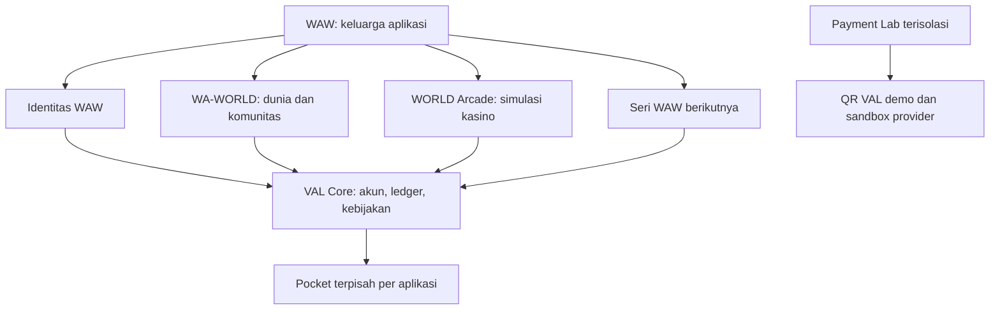

# WAW & VAL — peta pengembangan

Tanggal rancangan: 29 Oktober 2026. Status: **proposal dan panduan implementasi**, bukan fitur yang sudah aktif.

**VAL = Virtual AL**, kredit simulasi milik ekosistem WAW. Arah produk: hiburan virtual yang menyenangkan, mudah ditinggalkan, dan tidak mempunyai jalur ke uang nyata. Pengguna yang kesulitan mengendalikan permainan perlu perlindungan lebih kuat; mereka bukan segmen untuk dimaksimalkan durasi atau frekuensi bermainnya. Simulasi tanpa uang tetap dapat memicu dorongan bermain dan tidak boleh dipasarkan sebagai terapi kecanduan.

## Urutan baca

Untuk cara menyerahkan source dan menjalankan pekerjaan, mulai dari [panduan ZIP → ChatGPT → agent di folder](../UPGRADE-WORKFLOW.md).

Hasil pengerjaan aktual: [status implementasi dan pengujian](IMPLEMENTATION-STATUS.md), dimulai dari stabilitas scheduler multiplayer. Rancangan VAL di bawah tetap belum menjadi fitur aktif.

1. [Roadmap upgrade dan desain bermain aman](ROADMAP.md): temuan proyek, prioritas, tahapan, dan syarat rilis.
2. [Panduan khusus e-wallet VAL](VAL-WALLET.md): konsep dasar, ledger, arsitektur, API usulan, dan migrasi ACR.
3. [Lab QR VAL, DANA, dan QRIS](QR-PAYMENT-LAB.md): alur scan–konfirmasi–receipt, sandbox, dan pemisahan dari pembayaran nyata.
4. [Backlog awal dan kriteria penerimaan](BUILD-BACKLOG.md): pekerjaan pertama yang bisa langsung dipecah menjadi issue.
5. [Prompt memulai EV-wallet VAL](START-DEVELOPMENT-PROMPT.md): instruksi siap salin untuk implementasi Arcade terlebih dahulu, lalu WA-WORLD, beserta prompt melanjutkan sesi.

## Peta produk yang diusulkan

Nama keluarga **WAW** berasal dari permintaan pemilik. Hubungan merek dengan nama **WOW** yang masih muncul di README WA-WORLD adalah usulan konsolidasi; dokumen ini tidak menganggap seluruh seri WAW sudah tersedia.

## Dasar yang sudah diperiksa

| Komponen | Bukti lokal | Implikasi |
|---|---|---|
| Arcade RC3 | [package.json](../../package.json), [panduan RC3](../rc3/UPGRADE_RC3.md) | Node.js + SQLite + React/Vite; judul README diselaraskan dengan package RC3 pada 31 Oktober 2026 |
| Ledger ACR | [src/db.mjs](../../src/db.mjs) | Akun, transfer dua sisi, transaksi SQLite, audit dan outbox sudah ada |
| Cadangan kewajiban | [model database](../rc1/DATABASE.md), [baseline](../rc1/BASELINE-AND-DECISIONS.md) | Migrasi harus mempertahankan saldo, sesi, dan kewajiban lama |
| Auto-spin | [web/src/auto-spin.mjs](../../web/src/auto-spin.mjs) | Preset 10/30/50/100 dan pencarian bonus maksimum 500; batas UI bukan pengaman lintas kanal |
| WA-WORLD | Folder lokal saudara `../WA-WORLD-Starter`, package 3.4.0 dan README | Hub World/Games/Economy/Identity/Arena; ekonomi V dan kosmetik terikat akun |
| Konektor | [panduan RC1](../rc1/WA-CONNECTOR.md) | DM, handoff, token service; tidak menulis saldo VCUR |

Pemeriksaan WA-WORLD hanya mencakup metadata dan README, bukan audit implementasi ekonominya. Tidak membaca `.env`, database pemain, atau sesi autentikasi WA. Angka defisit dalam dokumen RC1 adalah snapshot historis, bukan hasil pemeriksaan saldo saat ini.

## Keputusan awal

- VAL adalah unit virtual tanpa kurs rupiah, pembelian saldo, penarikan, hadiah bernilai nyata, atau pasar sekunder.
- Satu identitas dan satu layar dompet dapat menampilkan beberapa **pocket**. VAL Arcade, VAL World, dan VAL Lab bukan saldo bebas dipindahkan satu sama lain.
- ACR dipindahkan bertahap ke VAL Arcade lewat migrasi yang dapat direkonsiliasi. V/VCUR WA-WORLD tetap terpisah sampai kontrak sumbernya diperiksa.
- MVP dimulai sebagai modul pada proses dan transaksi database Arcade yang sama. Layanan dompet bersama baru diekstrak setelah kontrak transaksi dan pemulihan teruji.
- Fitur belajar transfer pengguna tersedia di lab akun sintetis. Transfer antarpemain produksi ditunda agar tidak menjadi jalan jual-beli saldo atau menghindari batas bermain.
- QR internal bernama **QR VAL Demo**. QRIS resmi dan DANA dipelajari melalui lingkungan sandbox tersendiri; integrasi pembayaran uang nyata tidak menjadi sumber saldo kasino.

Dokumen ini menambahkan arah pengembangan. Untuk menjalankan versi yang ada, tetap gunakan runbook rilis. Endpoint, tabel, dan nama flag baru di dokumen WAW belum tersedia sampai diimplementasikan.
